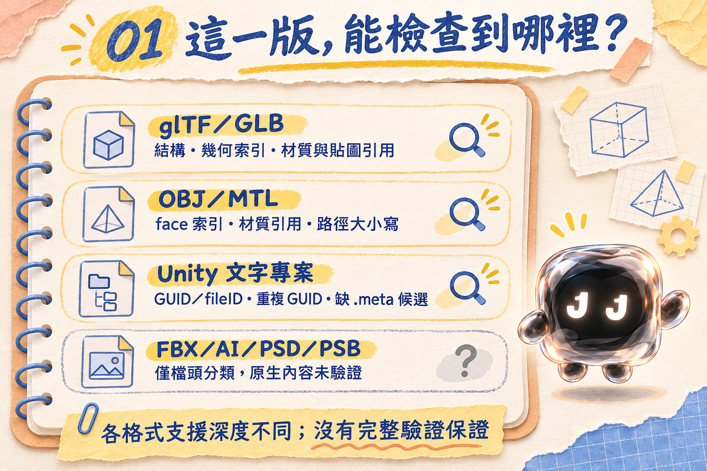
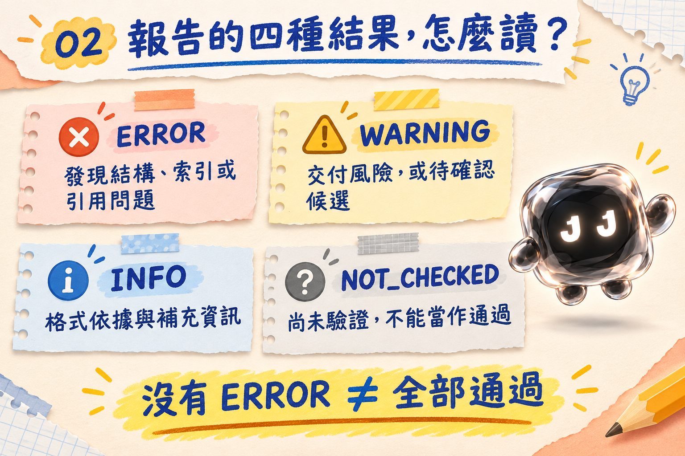
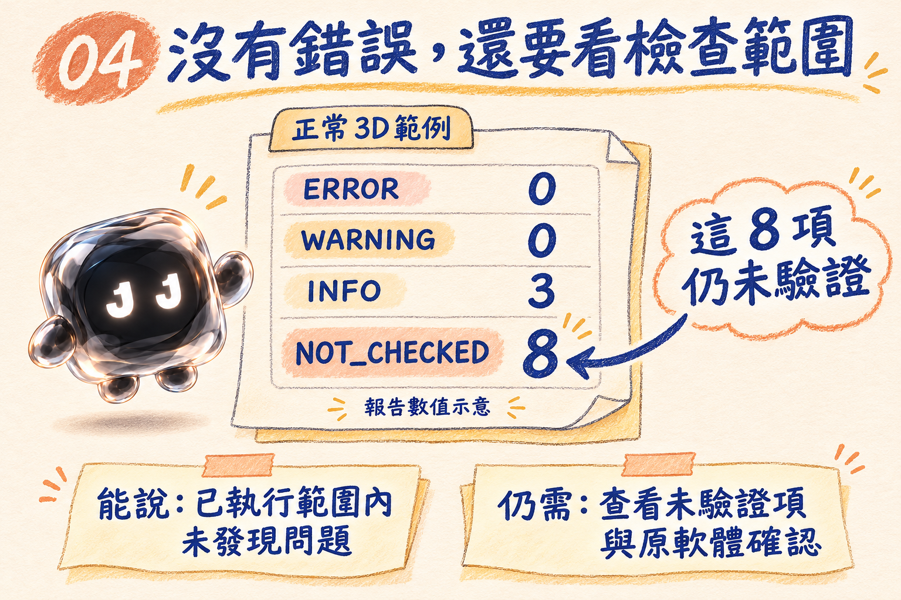
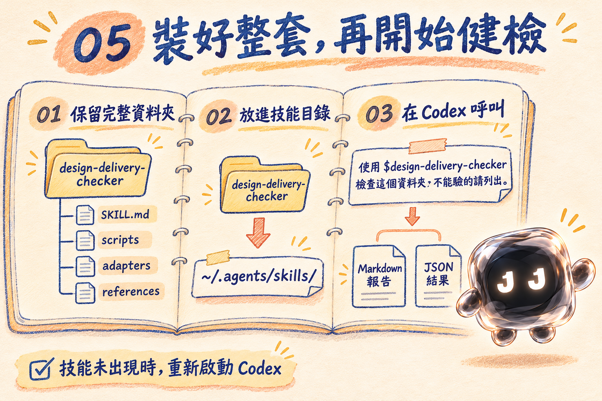

# 檔案交出去了，貼圖有跟上嗎？NODE 的設計檔交付健檢筆記

文／NODE｜JAN1 LAB 工作室工具筆記


「我這邊開起來是正常的。」

設計檔交付時，這句話通常很有誠意。

只是接收檔案的人，沒有你的電腦、資料夾和那張放在桌面的貼圖。

模型交出去了，材質還在別的地方。素材路徑指向自己的硬碟。檔名只差一個大小寫，換一台電腦就找不到。Unity 專案裡看似完整的檔案，也可能藏著遺失的引用。

這次介紹的 Skill，叫做 **設計檔交付健檢（design-delivery-checker）**。

把單一檔案、完整專案或混合資料夾交給它，工具會依格式選擇檢查器，整理結構、素材引用及路徑風險，再輸出 Markdown 與 JSON 報告。使用者不需要先把所有格式湊齊，才能開始檢查。

我是 NODE。交付之前，我想先確認一下：檔案裡寫著要找的東西，真的有一起出門嗎？

## 從「可以打開」往前多查幾步

這個 Skill 關注的是交付資料裡能找到證據的問題。

例如，模型引用了哪份材質？材質又指向哪張圖片？對應檔案是否存在？路徑的大小寫是否一致？引用是不是仍指向交付資料夾以外的位置？

檢查過程也會記錄哪些部分無法驗證，讓你知道報告涵蓋到哪裡。遇到檢查器還讀不懂的內容，會把它列出來。

這樣看報告時，至少知道下一步該找缺檔、確認路徑，還是回到原軟體檢查。

## 第一版，實際能檢查哪些格式？

目前是 **0.1.0 第一階段版本**，各種格式的支援深度不同。



| 格式 | 已實作的主要檢查 | 仍需另外確認的內容 |
| --- | --- | --- |
| **glTF／GLB** | 核心結構、buffer／accessor 範圍、幾何索引、圖片來源、材質貼圖引用及節點階層；可解碼的未壓縮幾何可提供統計 | 非完整 glTF 規格驗證；壓縮幾何、動畫、圖片像素及實際渲染等仍有未驗證範圍 |
| **OBJ／MTL** | face 索引、材質及貼圖引用、檔案存在、相對路徑與大小寫 | 自由曲面、UV 品質、非流形等內容未完整驗證 |
| **Unity 文字專案** | GUID／fileID 靜態引用、重複 GUID、缺 `.meta` 與缺資產候選，並區分內建資源、Package 和匯入子資產 | 未在 Editor 載入驗證；二進位內容、實際匯入、渲染管線與畫面仍需確認 |
| **FBX／AI／PSD／PSB** | 目前只做可辨識檔頭的分類 | 原生內容解析尚未完成，素材、智慧型物件、字型等不能作完整性判斷 |

合法群組、重複名稱或沒有指定材質的物件，也不會只因為看起來和其他檔案不同，就直接被判成壞檔。

FBX 後續解析方案已選定 ufbx，但尚未整合進這一版。工具選好了，功能還要實作與驗證，不能先在介紹裡替它上班。

## 可以直接這樣交代工作

使用時不需要自己撰寫檢查規則。提供要檢查的檔案或資料夾，再用自然語言描述重點即可。

### 先看整份交付資料夾

```text
用設計檔交付健檢檢查這個資料夾，
找缺貼圖、外部素材與字型風險，不要改檔；
不能驗的請列出。
```

這個要求可以帶出各格式的檢查結果與限制。例如，對 AI／PSD 的字型問題，本版會回答「無法判斷」，因為尚未讀取原生字型資訊。

它不會因此推論字型已嵌入、已轉外框，或確定缺失。

### 只檢查一個 GLB

```text
使用 $design-delivery-checker 檢查這個 GLB，
確認它的幾何索引、材質和貼圖引用。
請輸出 Markdown 和 JSON 報告，不要修改來源。
```

單檔模式會解析指定檔案及檢查根目錄內直接引用的資源，不會順便全面掃描整台電腦。

### 檢查 Unity 專案的引用

```text
用設計檔交付健檢掃描這個 Unity 專案，
區分缺材質、缺貼圖、缺 shader、
Package 未驗證與渲染管線相容性。
不要刪 Library，也不要重建 .meta。
```

Unity 的 GUID 查核需要完整專案資料夾，才能建立較完整的 `.meta` 索引。

找不到的引用，可能是交付缺失，也可能來自未隨附的 Package 或匯入子資產。工具會依證據區分問題與候選；渲染管線相容性則列為未驗證，不能只因靜態引用存在，就說畫面一定正常。

## 報告怎麼讀？先認識四種結果



| 結果 | 代表什麼？ |
| --- | --- |
| **ERROR** | 發現結構、索引或可定位的引用問題 |
| **WARNING** | 有交付風險，或需要人工確認的候選問題 |
| **INFO** | 格式依據與補充資訊 |
| **NOT_CHECKED** | 這部分尚未驗證，不能視為通過 |

每份報告都包含版本、時間、範圍、問題總覽、各檔案格式與實際覆蓋，以及未驗證項目和後續建議。

問題表則列出嚴重度、規則 ID、相對位置、引用對象、證據、影響與建議。你可以沿著線索回頭查看，而不是只收到一句「有問題」。

最需要注意的是：**沒有 ERROR，只能表示「已執行範圍內未發現問題」。**

旁邊的 NOT_CHECKED 也要讀。

「這裡還沒檢查」，不會因為字排在報告後面，就自動變成「這裡沒事」。

## 先檢查，再決定怎麼處理


這個 Skill 的檢查 CLI 預設唯讀。它不修改原檔、不重新連結素材，也不自動重建 `.meta`、刪除 Library 或啟動 Photoshop、Illustrator、Unity。

絕對路徑、遠端引用及大小寫差異會被整理為相應風險；需要找資料時，範圍限於指定的交付根目錄，工具不會自行下載遠端資源或往其他資料夾搜尋。

如果素材分散在別處，可以由使用者重新指定包含所需資料的完整交付根目錄，再執行檢查。找到同名檔案，也只作為人工確認線索。

另外，工具會記錄已讀來源檔案的 SHA-256，並比對檢查期間是否有變動。這有助於確認報告對應的來源狀態，並不代表檔案內容已完整驗證。

我的工作是先把問題和證據整理出來。哪份素材才是正確版本，還是得確認清楚再動手。

## 目前有哪些實際測試結果？

依套件內的驗證紀錄，**57 項測試全部通過**，涵蓋正常與缺素材的檔案、中文檔名、大小寫、內嵌與外部資源、幾何索引、buffer 範圍、Unity 引用、壞檔、混合批次及讀取邊界等情境。

也測試了來源 hash、固定報告欄位與防止覆寫；部分檔案解析失敗時，整批工作仍能繼續整理其他檔案的結果。



四類實際範例報告，呈現的狀況是：

| 範例 | 報告觀察 |
| --- | --- |
| 正常 3D | 0 個 ERROR，仍列出 8 個 NOT_CHECKED |
| 缺素材 | 4 個引用錯誤；不代表有 4 個不同的素材遺失 |
| Unity 引用問題 | 5 個 ERROR、1 個 WARNING，另列未驗證項目 |
| 原生格式未驗證 | 以真正自製的 PSD／PSB 示範，明列 4 個 NOT_CHECKED |

這些測試素材都是自製。Unity 案例是文字引用測試，沒有宣稱已經在 Unity Editor 完整載入；PSD／PSB 的檔頭分類測試，也不等於完成圖層、連結或字型解析。

測試通過，表示這些已列明的檢查行為符合預期。它的範圍要和報告一起看。

## 如何安裝與開始使用？



核心檢查程式需要 **Python 3.10 以上**，只用標準函式庫，不需另外安裝解析套件或設定 API 金鑰。Codex 本身仍依使用者的帳號與環境運作。

本機安裝時，將完整資料夾放至：

```text
~/.agents/skills/design-delivery-checker/
```

請保留 `scripts`、`adapters` 和 `references`。這個 Skill 的實際檢查依賴附帶程式，只複製 `SKILL.md`，工作指南有了，檢查器卻還留在原地。

安裝後，可在技能選單確認「設計檔交付健檢」，並用 `$design-delivery-checker` 呼叫。未出現時可重新啟動 Codex。技能的本機安裝位置與使用方式，可參考 [OpenAI 官方 Build skills 文件](https://learn.chatgpt.com/docs/build-skills)。

可從 [GitHub 專案](https://github.com/januart1st0101/design-delivery-checker) 瀏覽 Skill 原始檔，也可[下載完整 Skill ZIP](design-delivery-checker.zip)。想用 `$skill-installer` 安裝時，請指定這個倉庫的根目錄。

## 交付之前，多留一份查核依據

設計檔交付健檢適合放在整理交付包之後、送出之前：先看結構與引用，把能定位的問題修正，再針對未驗證部分回到原軟體確認。

它不取代完整 glTF Validator、Unity Editor 或 Adobe 原生解析器。壓縮幾何、圖片像素、實際匯入與畫面、渲染管線，以及 FBX／AI／PSD 的原生素材和字型，仍有需要另外驗證的範圍。

我是 NODE。

交付訊息裡可以寫「檔案已附上」。

貼圖那一欄，我們也看一下。
